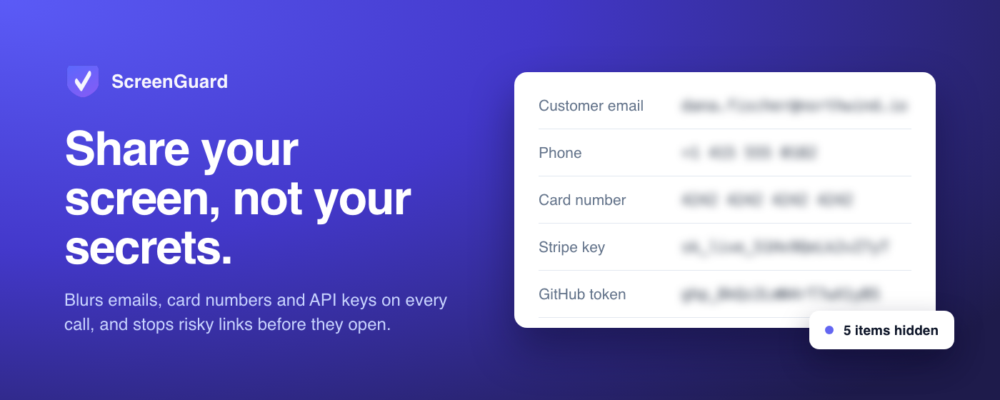
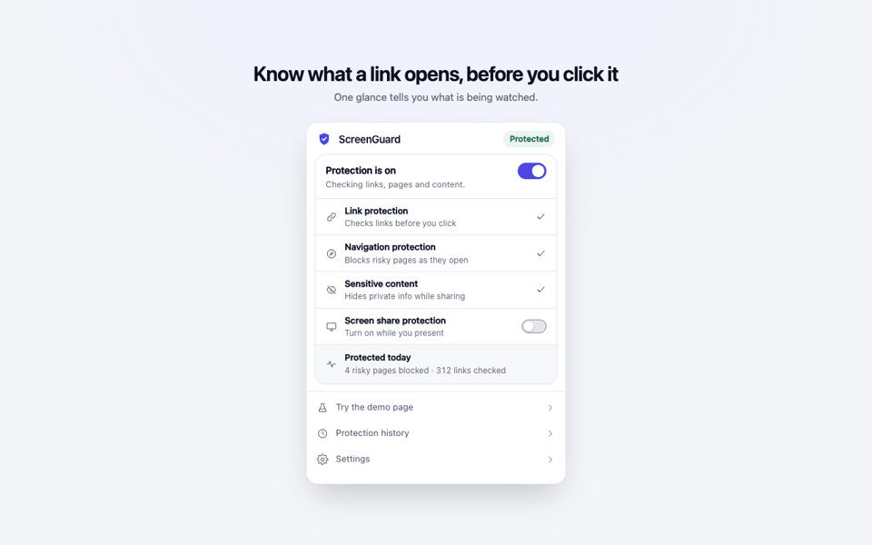
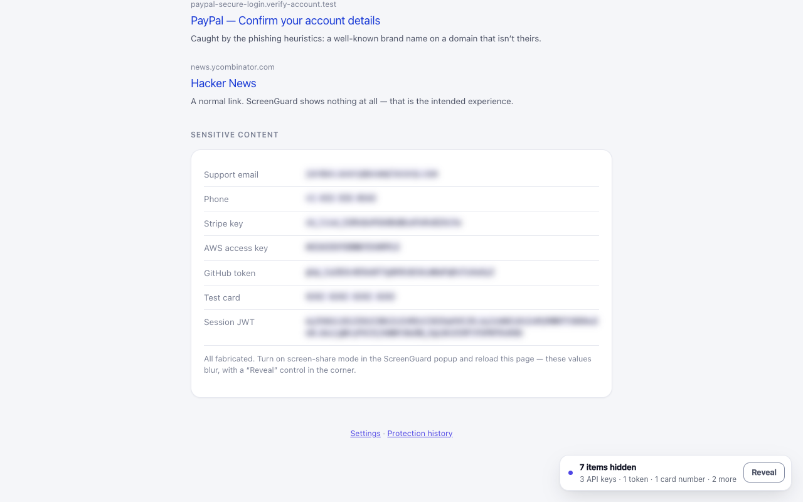
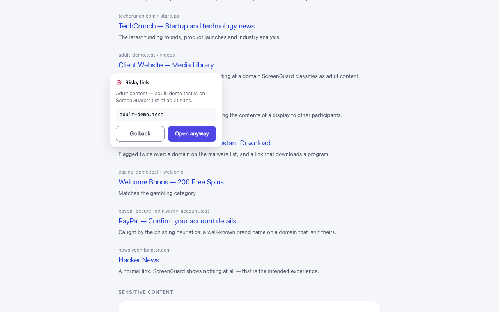
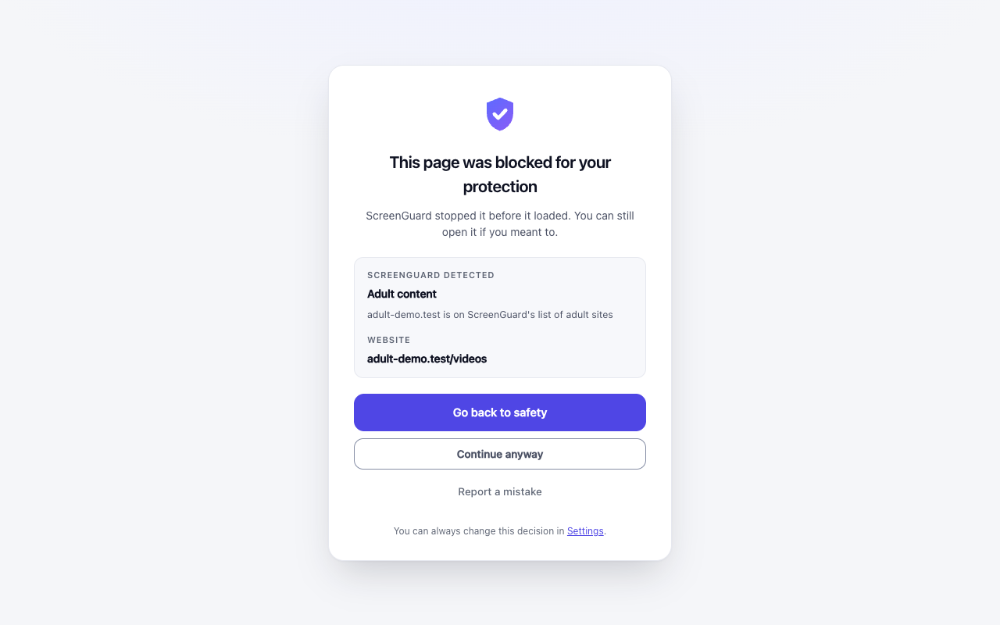
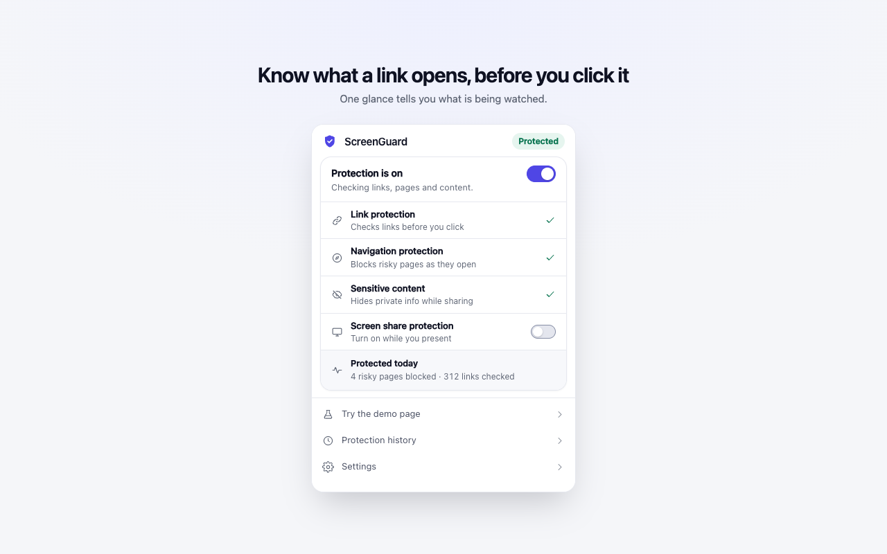

# ScreenGuard

[](https://github.com/orvi2014/screenguard/actions/workflows/verify.yml)
[](LICENSE)

<!-- Chrome Web Store badge: replace EXTENSION_ID with the 32-letter ID from the store URL, then uncomment.
[](https://chromewebstore.google.com/detail/EXTENSION_ID)
[](https://chromewebstore.google.com/detail/EXTENSION_ID)
-->

<p align="center">
  
</p>

**Never accidentally share what you shouldn't.**

ScreenGuard is a free, open-source Chrome extension for anyone who shares their screen:
sales demos, support calls, interviews, classes and streams. Flip "I'm sharing my
screen" before a call, or leave it always on, and it:

- **Blurs sensitive info** in the pages you show: email addresses, phone numbers, card
  numbers and API keys, in page text and form fields.
- **Blocks personal pages** such as webmail, banking and chat until sharing is off.
- **Stops risky links before they open**, so a phishing, adult or gambling page never
  lands on the shared screen. Brand lookalikes like `paypa1.com` or `paypal-login.com`
  are caught without flagging real sites like `google.fr` or `blog.google`.

Everything runs locally: no server, no account, no analytics. No URLs, page text or
browsing history ever leave the browser.

<p align="center">
  
</p>

## Install

- **Download a release:** grab `screenguard-<version>.zip` from
  [Releases](https://github.com/orvi2014/screenguard/releases/latest), unzip it, open
  `chrome://extensions`, turn on **Developer mode** and click **Load unpacked** on the
  unzipped folder.
- **Build from source:** see [Quick start](#quick-start) below.
<!-- Add the Chrome Web Store link here once the listing URL is known. -->

## Screenshots

| Sensitive info hidden while sharing | Hover warning on a risky link |
|---|---|
|  |  |
| **Risky page stopped before it loads** | **One switch before a call** |
|  |  |

---

## Quick start

```bash
npm install
npm run build
```

Then load it:

1. Open `chrome://extensions`
2. Turn on **Developer mode** (top right)
3. Click **Load unpacked**
4. Select the **`dist/`** folder

The welcome tour opens automatically on first install.

While developing, `npm run dev` rebuilds all three bundles on save. Chrome does not
hot-reload extensions, so press the ↻ button on the ScreenGuard card in
`chrome://extensions` after a change (and reload any open tab for content-script edits).

---

## Testing it

Open the demo page from the popup (**Test ScreenGuard**) or at
`chrome-extension://<id>/demo.html`. It looks like a page of search results and
contains a mix of safe and deliberately risky links.

| # | Test | What should happen |
|---|------|--------------------|
| 1 | Open the demo page | Safe results look completely untouched |
| 2 | Hover "Client Website — Media Library" | A small popover appears beside the link, naming the risk |
| 3 | Hover "Hacker News" | **Nothing happens** — that's the product working |
| 4 | Click "Welcome Bonus — 200 Free Spins" | Navigation is stopped; a confirmation dialog appears |
| 5 | Choose **Open anyway** | ScreenGuard steps aside and the browser proceeds |
| 6 | Type `adult-demo.test` in the address bar | The request is blocked; a warning page or Chrome’s blocked-page UI appears |
| 7 | Toggle **I'm sharing my screen** in the popup, reload the demo | The values at the bottom blur; a "7 sensitive items hidden" chip appears |
| 8 | Visit `mail.google.com` while sharing | Blocked as a personal page (allowed again once sharing is off) |
| 9 | Open **Protection history** | Every block, warning and allow is listed, newest first |
| 10 | Settings → Allowed websites | Add/remove a domain; removing it restores protection immediately |
| 11 | Settings → Blocked websites → add `example.com` | It is stopped before the request leaves the browser |
| 12 | Settings → Account | Google sign-in, or the clearly-labelled preview if it isn't configured |

> The flagged links point at reserved `.test` domains that intentionally don't resolve,
> so **Open anyway** ends on a browser "site can't be reached" page. That is expected —
> it proves ScreenGuard let the navigation through.

---

## Testing

```bash
npm test           # unit regressions: classification, policy, bypasses, storage, patterns and performance
npm run test:e2e   # browser checks, including real HTTP blocking and pre-paint redaction
```

The unit suite is built around **false positives**, because that is the failure
mode that gets a privacy extension uninstalled:

- **215 real websites** (news, banking, dev tools, universities, government, CDNs)
  must produce no UI at all.
- **77 adversarial look-alikes** — `essex.gov.uk`, `middlesex.edu`, `alphabet.com`,
  `bethesda.net`, `diabetes.org`, `camera.com`, `adult-education.org`,
  `sex-education.org`, `bet.com`, `nutcracker-ballet.org`, `torrentfreak.com` —
  must stay clean.
- **10 addiction-support services** — `gamblingtherapy.org`, `begambleaware.org`,
  `gamblersanonymous.org`, `pornaddictionrecovery.org` — must never be blocked.
  Blocking someone on their way to getting help is the worst thing this extension
  could do, so it has its own suite.
- **27 ordinary sentences** containing dates, versions, order numbers, git SHAs,
  UUIDs, hex colours, prices and coordinates must never be blurred.

The browser suite additionally proves ScreenGuard *doesn't break the web*: the
page's own click handlers still fire on safe links, page styles are untouched,
and nothing is added to the DOM until there is something to warn about. It also
walks every way a risky page can be reached — typed address, bookmark, server
redirect, meta refresh, JavaScript navigation, back button, `window.open`,
embedded frame — and checks each one is stopped.

---

## Design system

Tokens live in `src/ui/theme.css` and every colour pairing in it is **measured, not
eyeballed**. `test/contrast.test.ts` reads that stylesheet directly and asserts the
ratios, so a lighter grey cannot quietly ship:

- text tokens clear WCAG AA (4.5:1) against white, the tinted surface and the canvas;
- status colours clear 4.5:1 on white *and* on their own pill background;
- anything that outlines a control clears 3:1, per WCAG 1.4.11.

That audit found three real failures in the first pass — the muted grey used for almost
every description sat at 3.88:1, and the safe and warning colours were worse.

Other system rules the code holds to:

- **One icon family.** `src/ui/icons.tsx`, authored on a 24 grid with a 1.6 stroke and
  round joins. No icon font, no runtime dependency, no emoji standing in for a glyph.
- **State is never colour alone.** Every status carries an icon or a word beside it.
- **Motion is tokenised.** One easing curve, two durations, and `prefers-reduced-motion`
  honoured globally rather than per component.
- **Platform type.** Browser UI should look like browser UI, and a popup that must open
  instantly cannot afford a blocking webfont request.

---

## Architecture

```
src/
  risk/
    riskClassifier.ts   classifyUrl(url) -> RiskResult      (pure, offline, cached)
    policy.ts           evaluateUrl(url, settings) -> Verdict (applies user settings)
    data.ts             the local domain/keyword/TLD tables
  background/
    service-worker.ts   lifecycle, messages, badge
    navigationGuard.ts  typed URLs, bookmarks, redirects, history
    dnrRules.ts         declarativeNetRequest rules (block before the request)
    bypass.ts           short-lived "open anyway" grants
    riskEngine.ts       the facade the worker talks to
  content/
    index.ts            entry — runs in every frame, at document_start
    frame.ts            top-frame / display-frame detection
    frameGuard.ts       an embedded frame checks its own address and blocks itself
    relay.ts            cross-frame plumbing (dialogs, the hidden-items count)
    linkScanner.ts      lazy anchor classification (IntersectionObserver + MutationObserver)
    hoverWarning.ts     the hover popover
    clickInterceptor.ts capture-phase click blocking + confirmation dialog
    sensitiveDetector.ts blur / reveal machinery
    patterns.ts         the local secret-detection engine
    ui.ts               shadow-DOM host and styles
  popup/ settings/ history/ warning/ onboarding/   React surfaces
  auth/               optional Google sign-in (authService, googleAuth, config)
  storage/            chrome.storage wrapper, defensive on every read
  shared/             types, constants, utils
```

**The risk engine is the seam.** `classifyUrl()` is the only place a URL is judged, and
it is pure and synchronous. The bundled reputation database is built at release time
from reviewed public feeds, so installed copies never send browsing addresses away for
reputation checks. The popup, content script and worker all go through `evaluateUrl()`
and never see the implementation.

### How a URL is judged

Rules are ordered strongest-first and stop at the first match:

1. **Explicit domain list** — the only rule nothing can veto.
2. **Credentials embedded in the URL.**
3. **Known-good overrides** for names that would otherwise trip a heuristic.
4. **Risky TLDs** (`.xxx`, `.casino`, …).
5. **Unambiguous keywords** (`porn`, `hentai`, `casino`) anywhere in the hostname.
6. **Brand impersonation** — brand domains have explicit reviewed exceptions,
   including `google.de`, `amazon.co.uk` and `paypal.me`. A matching brand label
   under another suffix does not establish ownership.
7. **Program downloads**, unless the host is a normal software source.
8. **Public IP addresses** — loopback and RFC1918 are local development, not a risk.
9. **Self-sufficient words** (`escort`, `keygen`), veto-able by context.
10. **Ambiguous words** (`sex`, `adult`, `bet`, `poker`) — these only count when the
    word *is* the site's name, or a supporting word from the same category sits
    beside it. That single rule is what keeps `adult-education.org`,
    `sex-education.org` and `bet.com` clean while still catching
    `free-sex-videos.example`.
11. **Personal pages** — only ever acted on while screen sharing.

Two vetoes sit above the keyword rules: an **innocent-context** list (education,
health, government, research…) and a **recovery-service** list (therapy, addiction,
anonymous, helpline…). Both switch every keyword tier off.

### Three layers of protection

| Layer | Covers | Guarantee |
|-------|--------|-----------|
| `declarativeNetRequest` | The built-in risky-domain list and your own blocklist, for pages **and** embedded frames | The request never leaves the browser |
| `webNavigation.onBeforeNavigate` | Every heuristic match in a top-level page, plus screen-share strictness | Replaces the destination as the navigation starts |
| Content script | Link hover and click, plus an embedded frame guarding its own address | Stops the click in the capture phase, before the page's own handlers |

MV3 removed blocking `webRequest`, so a listener **cannot cancel** a navigation. That is
why anything knowable in advance is pushed into declarativeNetRequest, where it is
genuinely pre-request. Network rules use `block`, not `redirect`, and need no
explicit host permissions. The navigation listener supplies best-effort custom
warning pages and handles heuristic matches. Chrome's native blocked-page UI can
appear if that custom warning is unavailable.

### Every way into a website

| How the user gets there | Stopped by |
|---|---|
| Typed or pasted address, bookmark, history, back button | Navigation guard |
| Clicking a link (including `target="_blank"` and middle-click) | Content script, in the capture phase |
| Server redirect, meta refresh, `location.href`, `window.open` | Navigation guard |
| A risky page embedded in an `<iframe>` | Network rules, then the frame's own guard |
| A risky link *inside* an iframe | Content script in that frame; the dialog is relayed to the top frame |

### Embedded frames

Listed domains and your blocklist are stopped by Chrome before the iframe request
is sent. These frames show Chrome's native blocked-content UI; there is no custom
"Show anyway" button inside them. To permit one, add its domain to Allowed websites
in Settings and reload the page.

For heuristic matches, the frame's content script checks its own address at
`document_start` and replaces itself with a compact warning. This keeps the parent
page intact. Clicks inside already-loaded frames still use the confirmation flow.

Because a 300×200 advertising frame is no place for a dialog, a risky click inside a
frame is relayed through the background worker to the **top** frame, which shows the
confirmation and reports the choice back. The "N sensitive items hidden" indicator works
the same way: frames report their counts, the top frame shows one total for the tab, and
revealing there reveals everywhere. Frames too small to display anything — tracking
pixels, auth handshakes — are skipped entirely.

None of this needed a new permission.

---

## Permissions, and why each one is needed

| Permission | Why |
|---|---|
| `storage` | Settings, allow/block lists, history and counters — all local |
| `webNavigation` | Detect typed URLs, bookmarks and redirects as navigation starts |
| `declarativeNetRequest` | Block known-risky domains without ever seeing your traffic |
| `alarms` | Expire temporary, tab-scoped "open anyway" grants |
| `identity` | **Optional** — requested only when you tap "Continue with Google" |

**No explicit `host_permissions` or `optional_host_permissions` are requested.**
Native DNR `block` and `allow` rules work with `declarativeNetRequest` alone.
Content-script matches still cover HTTP and HTTPS pages for local link checks and
redaction. They do not grant DNR redirect access or access to `tab.url`; the popup
and existing-tab checks ask content scripts to report their own addresses.

The extension still has broad in-page access and may show a website-access warning.
Removing explicit host permissions does not guarantee a particular store review time.

Also not requested: `activeTab`, `tabs`, `history`, `webRequest`, `bookmarks`,
`downloads`, `cookies`, `scripting`.

---

## Privacy

- Classification is a local table lookup plus string heuristics. No network calls.
- Sensitive-content detection is regex over the page's own text, in the page. Nothing
  is sent to the background worker, a server, or any AI API.
- No analytics, no telemetry, no remote config.
- Protection history lives in `chrome.storage.local` and can be cleared from its page.

---

## Optional Google sign-in

Authentication is **not** required and protection never depends on it. Local storage is
the source of truth; sign-in only lays the groundwork for future cross-device sync,
subscriptions and billing.

Without configuration the extension builds and runs normally — Settings shows an
explanation plus a clearly labelled *"Preview the signed-in state"* fallback.

To enable it:

1. Create a Supabase project and turn on the Google provider.
2. Copy `.env.example` to `.env` and fill in `VITE_SUPABASE_URL` and `VITE_SUPABASE_ANON_KEY`.
3. Add `https://<extension-id>.chromiumapp.org/` to Supabase's allowed redirect URLs.
   An unpacked extension's id is shown in `chrome://extensions`; add a `"key"` to
   `public/manifest.json` if you need it to stay the same across machines.
4. `npm run build`, then reload the extension.

The flow uses `chrome.identity.launchWebAuthFlow` against Supabase's OAuth endpoint —
no Supabase SDK is bundled, which keeps the dependency list to React alone.

---

## Known limitations

These are real constraints, not omissions:

- **Native blocked-frame UI.** Listed and user-blocked iframes show Chrome's own
  blocked-content UI. Custom top-level warning pages are best effort; network
  blocking remains effective even when Chrome shows its native error page.
- **A navigation cannot be cancelled from JavaScript in MV3.** Heuristic verdicts replace
  the tab's destination rather than stopping it. Known-bad domains go through
  declarativeNetRequest instead, which *is* pre-request.
- **Automatic screen-share detection is not possible** from extension APIs. Chrome exposes
  no signal for "this tab or display is being captured by another app". Rather than fake
  it, ScreenGuard ships a manual switch; the rest of the architecture is ready for an
  automatic trigger the day one exists.
- **`target="_blank"` and JS-driven navigation.** Real anchors are intercepted in the
  capture phase. A link opened purely by script (`window.open` from a click handler with
  no `href`) has no destination to inspect before the fact — the navigation guard catches
  it a moment later instead.
- **Reputation data is release-time data.** The bundled category database is built from
  reviewed public adult and gambling feeds using `npm run reputation`; it is not
  remotely updated after installation. Its metadata records the source URLs, generated
  time and domain count. Heuristics and the false-positive corpus remain important for
  newly registered domains and phishing.
- **Homograph detection is deliberately narrow.** ScreenGuard warns on an IDN label
  that mixes Latin, Cyrillic or Greek scripts - a common visual-confusable pattern -
  while leaving single-script international domains alone. It cannot detect every
  lookalike or judge an image-based imitation.
- **Generic phishing shapes are barely used.** Beyond brand impersonation and
  credentials-in-URL, hostname-shape heuristics produced more false positives
  (`login.microsoftonline.com`, `s3.eu-west-1.amazonaws.com`) than real catches, so
  they were cut back to one narrow rule.
- **Sensitive-content detection is pattern based.** Changed text and inserted subtrees
  are scanned from mutation callbacks before the next paint. Large scans run in
  chunks with the page temporarily concealed until scanning finishes; there is no
  6,000-node cutoff. Initialization also conceals the page while settings load.
  This is visual protection, not removal of secrets from the DOM.
  It catches emails, phone numbers,
  Luhn-valid card numbers, MOD-97-valid IBANs, JWTs, database credentials and common
  API-key shapes. Context-labelled high-entropy secrets are also covered. It will miss things, and it
  only rewrites text nodes — not canvas, images or PDFs (text inside iframes *is*
  covered).
- **QR detection depends on Chrome support.** While screen sharing, ScreenGuard uses
  Chrome's native `BarcodeDetector` when present to locally blur QR images containing
  a blocked destination. It does not upload the image; browsers without that native API
  simply skip QR scanning.
- **Cloud visual detection is optional.** If you explicitly add a Gemini API key and
  turn it on, up to three visible thumbnails are sent directly to Google Gemini for an
  explicit-content classification. Keep it off for strictly local-only protection.
- **Settings are per device.** Allow and block lists, categories and history live in
  `chrome.storage.local`. Signing in exists as groundwork and is clearly labelled as
  changing nothing today; cross-device sync is deliberately not in this version, and the
  UI does not claim otherwise.
- **Hover warnings are a top-frame feature.** Inside an iframe the popover would be
  positioned against a viewport a few hundred pixels wide and get clipped, so frames
  get click interception rather than hover previews. Clicks are protected everywhere.
- **Frames smaller than 80×60 are skipped.** They cannot show anything to anyone, and
  scanning every tracking pixel on every page is where extensions start slowing the
  browser down.
- **Content scripts can't run on extension pages**, so `demo.html` loads the same built
  `content.js` with a `<script>` tag. It is byte-for-byte the bundle that runs on real sites.

---

## Reporting a problem

From inside the extension: **Settings › Help**, or the "Tell the developer it was
wrong" link on any block page. Both open a pre-filled message in your own mail
client — nothing is sent automatically, and no browsing data is attached.

Or write directly to **hello@robatdasorvi.com**. A site flagged by mistake is the
most useful thing you can send: it goes straight into the false-positive corpus in
`test/corpus.ts`, which is how `bet.com`, `adult-education.org` and the
addiction-support sites got fixed.

---

## Commands

```bash
npm install       # install dependencies
npm run dev       # watch-build all three bundles
npm run build     # icons + typecheck + production build into dist/
npm test          # unit suite
npm run test:e2e  # browser suite (needs a build first)
npm run typecheck # TypeScript only
npm run icons     # regenerate the shield PNGs (no image dependencies)
npm run clean     # remove dist/
```

### Protection regression coverage

The browser suite uses a real local HTTP server to verify blocked page and iframe
requests never reach the destination. It also checks sharing enabled with a private
tab already open, initial and changing text at animation frames, continuous page
updates, redaction beyond 6,000 ordinary nodes, and destination-tab allowances.
Unit regressions cover repeated and concurrent grants, expiry, tab closure, orphan
rule cleanup, allocation against rules surviving a worker restart, and failed writes.

Temporary allowances last up to two minutes in their destination tab. Repeated
allowances replace the previous network rule. A scheduled alarm expires grants;
worker wake and tab closure also reconcile persisted records with Chrome's rules.

---

## License

[MIT](LICENSE) © 2026 Robat Das
